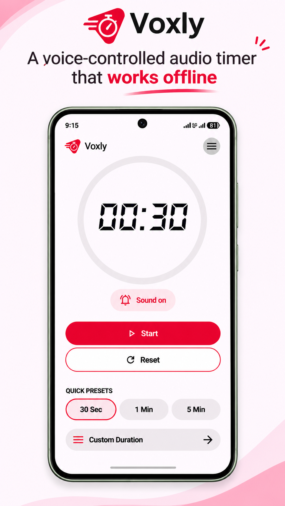
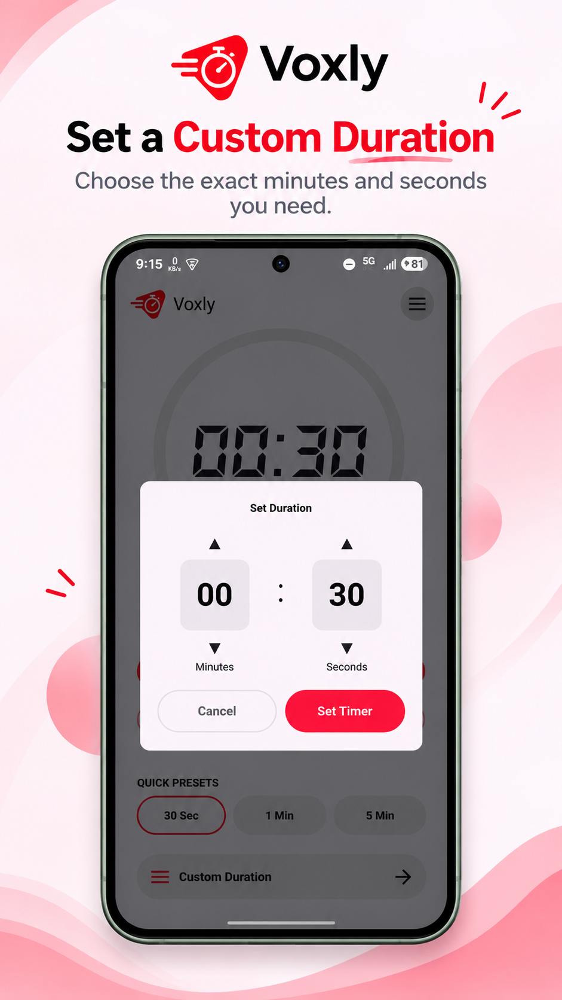
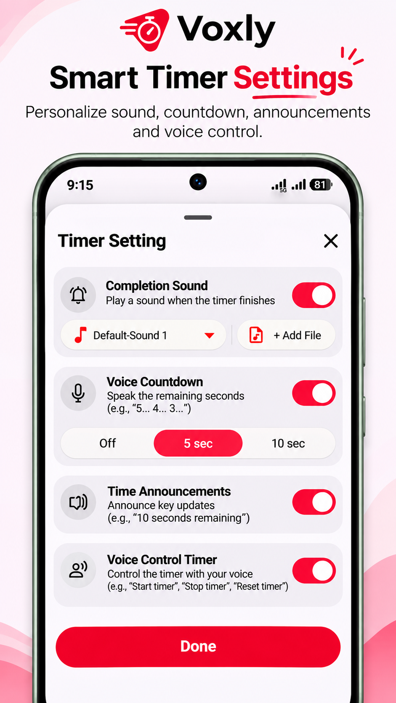

# Voxly – Offline Voice-Controlled Timer

**A simple audio timer that lets you control time with your voice.**

Voxly is an Android timer application built to make practice sessions easier to manage with hands-free voice commands, customizable audio alerts, and a simple interface.

## Why I Built Voxly

The idea came from a real problem I noticed while my brother was training a group of students.

During practice sessions, he often had to touch his phone repeatedly to start, pause, or reset the timer while guiding students. These small interruptions took his attention away from the session.

I explored timer apps on the Play Store, but the options I tried felt more complex than what he needed for this simple task.

So I decided to build something focused: a timer that is simple to use and can be controlled through voice commands.

That is how **Voxly** started.

## Features

- **Offline Voice Control:** Start, pause, and reset the timer using English voice commands powered by Vosk.
- **Voice Countdown:** Hear the remaining time with configurable 5-second or 10-second countdown options.
- **Voice Announcements:** Enable spoken timer updates, such as "10 seconds remaining".
- **Custom Audio Alerts:** Choose from built-in completion sounds or import your own audio file.
- **Quick Timer Presets:** Set 30-second, 1-minute, or 5-minute timers with one tap.
- **Custom Duration:** Set your own timer duration in minutes and seconds.
- **Simple Timer Interface:** View the countdown with a circular progress indicator and digital timer display.
- **Saved Preferences:** Selected sounds and voice settings are stored locally using Jetpack DataStore.

## UI Previews

<p align="center">
  
  
  
</p>

*Note: These are illustrative UI design previews. Refer to the running application for the actual interface and behavior.*

## Technology Stack

| Category | Technologies |
|---|---|
| Language | Kotlin |
| UI | Jetpack Compose, Material 3 |
| Architecture | MVVM |
| State Management | StateFlow, LiveData |
| Asynchronous Tasks | Kotlin Coroutines |
| Speech Recognition | Vosk Offline Speech Recognition |
| Text-to-Speech | Android TextToSpeech |
| Audio Playback | Android SoundPool |
| Local Preferences | Jetpack DataStore |
| Build System | Gradle Kotlin DSL |

## Voice Commands

With Voice Control enabled and microphone permission granted, you can use:

| Command | Action |
|---|---|
| Start | Start the timer |
| Pause | Pause the timer |
| Stop | Pause the timer |
| Reset | Reset the timer |

Vosk handles voice recognition locally using the bundled English speech model.

## How It Works

1. Open Voxly and choose a quick preset or custom duration.
2. Enable voice control from Timer Settings and grant microphone permission.
3. Use voice commands to control the timer during your session.
4. Customize countdown announcements and completion sounds according to your preference.

## Getting Started

### Requirements

- Android Studio
- Android SDK 37 for compiling the current project
- Android 9.0 (API 28) or later
- JDK 11 compatible build environment

### Clone the Repository

```bash
git clone https://github.com/dharmikchitroda/Voxly.git
cd Voxly
```

Open the project in Android Studio and allow Gradle to sync.

### Build the App

**Windows**

```bat
gradlew.bat assembleDebug
```

**macOS/Linux**

```bash
./gradlew assembleDebug
```

The debug APK will be generated at:

```text
app/build/outputs/apk/debug/
```

## Development Highlights

Building Voxly helped me gain practical experience with:

- Building Android interfaces using Jetpack Compose.
- Implementing MVVM with ViewModel and StateFlow.
- Integrating offline speech recognition using Vosk.
- Working with Android Text-to-Speech.
- Managing audio playback and custom audio files.
- Saving user preferences with Jetpack DataStore.
- Building a solution around an everyday real-world problem.

---

**Built with Kotlin and Jetpack Compose.**

*Designed to make practice sessions simpler, with fewer interruptions and hands-free timer control.*
